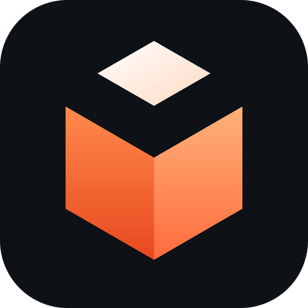

<p align="center">
  
</p>

<h1 align="center">Vox Launcher</h1>

<p align="center">
  <b>A fast, good-looking launcher for Minecraft: Java Edition.</b><br>
  Manage as many instances as you like, install mods and modpacks in a click, and get playing quickly.
</p>

<p align="center">
  <a href="https://github.com/sylphiras/vox-launcher/releases/latest"></a>
  
  
  <a href="https://github.com/sylphiras/vox-launcher/issues"></a>
</p>

<p align="center">
  <a href="https://github.com/sylphiras/vox-launcher/releases/latest">
    
  </a>
</p>

<p align="center">
  <a href="#-why-vox">Why Vox</a> •
  <a href="#-features">Features</a> •
  <a href="#-getting-started">Getting started</a> •
  <a href="#-your-data">Your data</a> •
  <a href="#-help--feedback">Help</a>
</p>

---

## ✨ Why Vox?

<table>
  <tr>
    <td width="50%" valign="top">
      <h3>⚡ Quick to open, light on memory</h3>
      Uses your system's built-in web view instead of bundling a whole browser, so it starts fast and stays small.
    </td>
    <td width="50%" valign="top">
      <h3>🚀 Quick to launch</h3>
      Once a game is set up, launching it doesn't re-download or re-check anything.
    </td>
  </tr>
  <tr>
    <td width="50%" valign="top">
      <h3>🎨 Looks the way you want</h3>
      Four themes, four layouts *(in alpha)*, and your own accent colour.
    </td>
    <td width="50%" valign="top">
      <h3>📦 Everything in one place</h3>
      Instances, mods, worlds, screenshots, skins and logs, all inside the launcher.
    </td>
  </tr>
</table>

---

## 🧩 Features

### 🗂️ Instances

| | |
|---|---|
| **Loaders** | Vanilla, **Fabric**, **Quilt**, **Forge** and **NeoForge** |
| **Organise** | Groups, icons, notes and play time for every instance |
| **Share** | Duplicate, delete, export and import instances (`.zip`) |
| **Tune** | Per-instance Java, memory, game window size, launch arguments, and commands that run before and after the game |

### 🔧 Mods and modpacks

- 🔍 Search **Modrinth** from inside the launcher
- 🖱️ One-click install, with required dependencies added for you
- 🔀 Turn mods on or off, delete them, and check for updates
- 📥 Install or import **Modrinth modpacks** (`.mrpack`)
- 🎞️ Resource packs and shader packs get the same treatment

### 🌍 Worlds, screenshots and servers

- 💾 Back up and delete worlds
- 📸 Browse and delete screenshots
- 🖧 Edit your multiplayer server list without starting the game
- 📜 Read game logs and crash reports

### 🛟 Crash helper

> When the game stops unexpectedly, Vox reads the crash report and explains in plain English what probably went wrong. Where it can, it offers a button that fixes it.

| Problem | Explained |
|---|---|
| 🧠 | Out of memory |
| ☕ | The wrong Java |
| 🧱 | A missing mod |
| 🎮 | A graphics driver problem |
| 🩹 | A damaged file |

### 👤 Accounts and skins

- 🔐 Sign in with your Microsoft account, or add an offline profile for singleplayer
- 🧍 **Skin library:** save skins, switch between them in one click, preview them from the front and back
- ⬆️ Upload a skin, reset it, or change your cape

### 🔄 Sync your settings

Copy your keybinds and options from your regular `.minecraft` folder (or another instance) into any instance, once or automatically every time you launch.

### 🎨 Make it yours

| | |
|---|---|
| **Themes** | Voxel *(default)*, Sleek, Bold and Minimal |
| **Layouts** | Cover, Dense, Glass and Classic *(currently in alpha)* |
| **Appearance** | Accent colour, interface size, compact mode and reduced motion |
| **Console** | Optional pop-up that shows game output when you launch |
| **Notifications** | Desktop notifications when downloads and installs finish |
| **Discord** | Rich Presence, with an optional "show the server I'm on" switch |

### 🔔 Stay up to date

Vox checks for new versions when it starts and can install them for you. If you ever want to remove it, there's an **Uninstall** button in Settings that lets you keep or delete your data.

### 🎯 Vox Client *(optional)*

A small Fabric mod you can add to any Fabric or Quilt instance with one click:

- 📊 FPS and CPS counters
- ⌨️ Keystrokes
- 🔭 Zoom key

It's client-side only, and you can remove it just as easily.

> [!NOTE]
> Vox Client is currently available for Minecraft **1.21.4**.

---

## 🚀 Getting started

1. ⬇️ Go to the [**Releases**](https://github.com/sylphiras/vox-launcher/releases/latest) page and download the Windows installer.
2. ▶️ Run it. No administrator rights are needed.
3. ➕ Open Vox Launcher, choose **New instance**, pick a Minecraft version and a mod loader, and press **Play**.
4. 🧩 Want mods? Open **Discover** to find them.

> [!TIP]
> To play online, add your Microsoft account under **Accounts**. Offline profiles work for singleplayer and LAN.

---

## 📁 Your data

Everything lives in:

```
%APPDATA%\Vox Launcher\data
```

Open it from **Settings → Data and about**. Uninstalling keeps it unless you choose otherwise.

---

## 💬 Help & feedback

Found a bug or have an idea? [**Open an issue**](https://github.com/sylphiras/vox-launcher/issues).

> [!TIP]
> If the game crashed, use **Copy report** in the crash helper and paste it into your issue.

---

## 🛠️ Building it yourself

See [DEVELOPING.md](DEVELOPING.md).

---

<p align="center">
  <sub>
    Copyright © 2026 sylphiras. All rights reserved, see <a href="LICENSE.md">LICENSE</a>.<br>
    Vox Launcher is not affiliated with Mojang Studios or Microsoft. Minecraft is a trademark of Mojang Studios.
  </sub>
</p>
